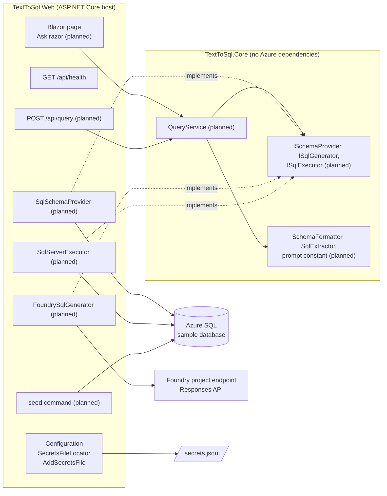
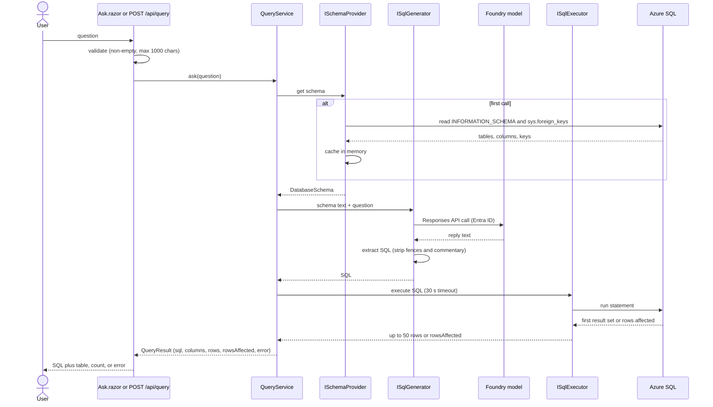

# Architecture

This page describes how the Text to SQL app is put together. The intended design and the reasoning behind it live in [plan.md](plan.md); the scope and acceptance criteria live in [requirements.md](requirements.md). Where the code and the plan differ, the code wins and this page says so.

> **Status:** phase 1 is built: the solution, configuration loading (including the `secrets.json` lookup), `GET /api/health`, and the default Blazor layout with a placeholder home page. `TextToSql.Core` has no code yet. Every component below that carries a Planned marker is from the plan.

## Components

| Project | Responsibility | State |
|---|---|---|
| `src/TextToSql.Web` | The single host: configuration loading, logging, DI wiring, the `/api/*` endpoints, the Blazor UI, the `seed` command, and the Azure implementations of the Core interfaces. | Built: `Program.cs`, `Configuration/`, `/api/health`, layout and placeholder page. The rest is planned (phases 2–4). |
| `src/TextToSql.Core` | Domain types (`DatabaseSchema`, `QueryResult`), the interfaces, `QueryService`, the prompt constant, schema-to-text formatting, and SQL extraction from model output. | Project exists, no code yet (phases 2–3). |
| `tests/TextToSql.Tests` | xUnit tests: the `secrets.json` locator, configuration precedence, and endpoints through `WebApplicationFactory`; later, fakes for the Core interfaces and `Live`-tagged integration tests. | 11 unit tests today. |

The website and the API are one ASP.NET Core process (plan decision D1). The Blazor page will call `QueryService` in-process rather than over HTTP, so both paths share the same logic.

## Main flow: one question

> Planned: not yet implemented (phases 2–4).

## Key components

### Configuration (built)

- `SecretsFileLocator.Locate(secretsPathVariable, startDirectory)` returns a `SecretsLookup(Path, Description)`. It uses `SECRETS_PATH` if set; otherwise it walks up from the start directory to the first folder containing a `.git` folder or file; if that folder is a git worktree and has no `secrets.json`, it follows the `gitdir:` line in the `.git` file back to the main checkout. A missing file is reported in `Description`, never thrown.
- `SecretsConfigurationExtensions.AddSecretsFile` inserts `secrets.json` just before the environment-variables source, so the order is `appsettings*.json` → `secrets.json` → environment variables → command line (later wins).
- `Program.cs` skips the secrets lookup in the `Testing` environment, so tests never read `secrets.json`. At startup it logs where the file was found, or a warning saying why it was not.

Details and every key: [configuration.md](configuration.md).

### Schema reading (planned, phase 2)

- `ISchemaProvider` / `SqlSchemaProvider` reads tables, columns, types, primary keys, and foreign keys from `INFORMATION_SCHEMA` and `sys.foreign_keys`, and caches the result in memory (D5).
- `SchemaFormatter` (Core) renders it as compact prompt text: `Table(col type PK, col type FK->Table.col)`.

### SQL generation (planned, phase 3)

- `ISqlGenerator` / `FoundrySqlGenerator` calls the model through the Foundry **project endpoint** with the **Responses API**, using `AIProjectClient` and `DefaultAzureCredential` (D2). Not the Assistants API and not a Foundry agent.
- The prompt is a constant in Core; it states T-SQL and includes the formatted schema and the question only.
- `SqlExtractor` strips markdown fences and commentary from the reply.

### Execution (planned, phase 3)

- `ISqlExecutor` / `SqlServerExecutor` runs the SQL through `Microsoft.Data.SqlClient` with `Authentication=Active Directory Default` (D3), a 30-second command timeout, and returns the first result set capped at 50 rows, or the rows-affected count for non-queries (D4).

### Extension points

- Swap the model or database by providing another implementation of `ISqlGenerator`, `ISchemaProvider`, or `ISqlExecutor` and registering it in `Program.cs`; tests do exactly this with fakes.
- Change the prompt in its Core constant, not inline at the call site.

## Decisions

The decisions and their trade-offs are recorded in [plan.md](plan.md#decisions). In short:

| # | Decision |
|---|---|
| D1 | One ASP.NET Core project hosts both the minimal API and the Blazor Web App (Interactive Server). |
| D2 | Plain model call through the Foundry project endpoint with the Responses API and Entra ID authentication. |
| D3 | Azure SQL through `Microsoft.Data.SqlClient` with `Authentication=Active Directory Default`. |
| D4 | Generated SQL runs as-is: no statement filtering, first result set, 50-row cap, 30-second timeout. |
| D5 | Schema read once, cached, and sent as compact text; only the schema and the question go to the model. |
| D6 | xUnit with fakes for unit tests and `Category=Live` traits for integration tests. |

## Error handling

Built today:

- A missing or unresolvable `secrets.json` is a logged warning at startup, not a crash.
- Outside Development, unhandled exceptions go to the `/Error` page (`UseExceptionHandler`) and HSTS is on; status-code pages re-execute to `/not-found`.

Planned (phase 3, from the plan):

| Situation | HTTP status | Body |
|---|---|---|
| Success | 200 | SQL plus rows (max 50) or rows affected |
| Empty or over-long question | 400 | Validation error; the model is not called |
| Generated SQL fails to execute | 422 | The SQL and the database error message; no retry |
| Model call fails (auth, network) | 502 | A readable message, no stack trace |

Phase 5 (optional) adds clear startup errors that name a missing configuration key, and handling for cancelled requests and timeouts.

## Logging

- Console logging through `ILogger`, configured in `appsettings.json` (`Default: Information`, `Microsoft.AspNetCore: Warning`).
- Built: the startup message about `secrets.json` logs only its path or the reason it was not found.
- Planned (phase 3): the question, the generated SQL, timings, and errors. Result rows and secrets are never logged.

## Security notes

- **What goes to the model:** only the formatted schema (table and column names, types, keys) and the user's question. No row data, connection strings, or secrets (requirements boundary, AC3).
- **Authentication:** Microsoft Entra ID everywhere. Locally that is the developer's `az login` through `DefaultAzureCredential`; when hosted it is the app's managed identity. No API keys or SQL passwords are used. Foundry needs the **Foundry User** role on the project; Azure SQL needs a database user with read, write, and DDL rights.
- **Secrets:** `secrets.json` is gitignored, read only for local development, and never logged; tests run in the `Testing` environment and never read it.
- **Generated SQL is not filtered** (D4, a deliberate user decision). Any statement, including `DROP`, runs against the configured database. Use only the disposable sample database; `seed` restores it.
- **No authentication on the app itself.** Anyone who can reach the port can run SQL through it. Run it locally only.
