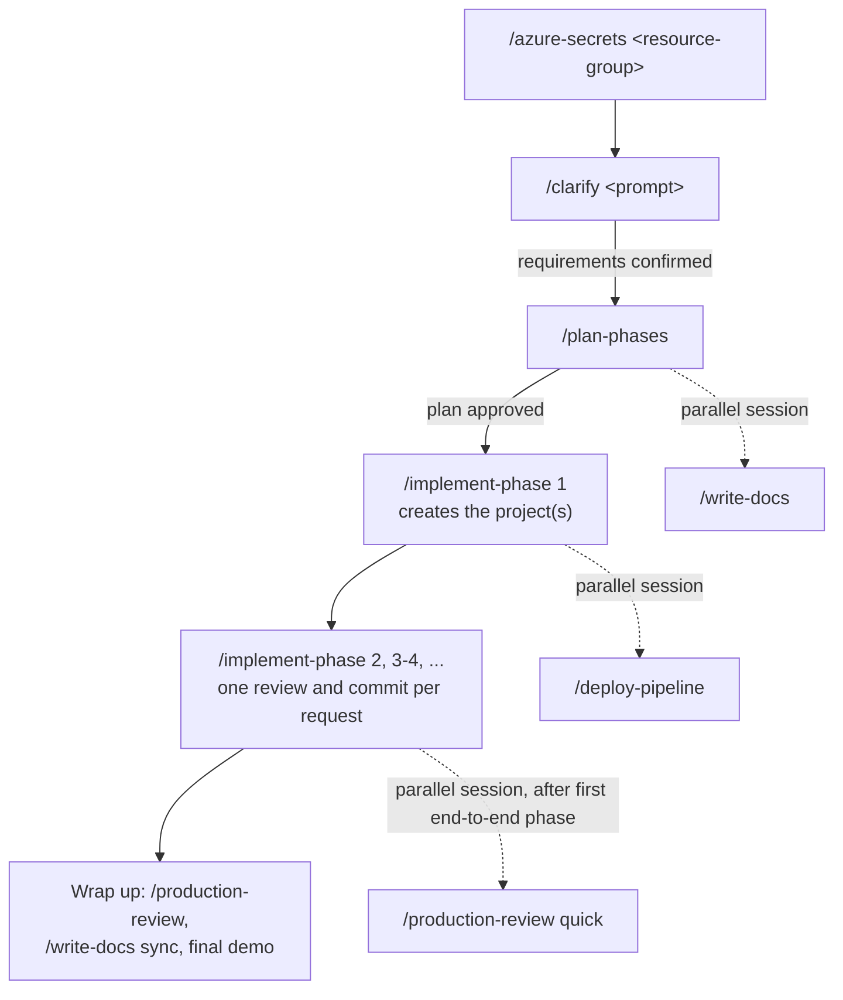

# Development workflow

This repository was built live with Claude Code, in tested phases, using the project skills in `.claude/skills/` and the rules in [`CLAUDE.md`](../CLAUDE.md). This page keeps the description of that kit; the application itself is described in the [README](../README.md).

## What's here

| Path | Purpose |
|---|---|
| `CLAUDE.md` | Working rules for Claude: accuracy and integrity, workflow, definition of done, repository layout, testing, secrets handling, Azure usage, parallel-session file ownership |
| `.claude/settings.json` | Project permissions (build tools, git, read-only Azure CLI, read access to `secrets.json`) and the plugins the project uses |
| `.claude/skills/` | Project skills (see below) |
| `secrets.example.json` | Shape of the gitignored `secrets.json` that holds Azure resource details and keys |

## Prerequisites for the kit

Do these once per machine, before a session:

- Open the repo in Claude Code once and accept the workspace trust prompt, so project permissions and plugin marketplaces apply.
- Install the plugins. Enabling them in `.claude/settings.json` does not install them:
  - `/plugin install pr-review-toolkit@claude-plugins-official` and `/plugin install claude-security@claude-plugins-official`
  - For .NET projects: `/plugin marketplace add dotnet/skills`, `/plugin install dotnet@dotnet-agent-skills`, `/plugin install dotnet-test@dotnet-agent-skills`, and `/plugin install csharp-lsp@claude-plugins-official`
  - Restart Claude Code, then check that `/plugin` and `/skills` list them.
- Tools: Git, Azure CLI, GitHub CLI (`gh`, signed in, for the pipeline skill), and Python 3.9+ (used by `claude-security`). Add the SDK or runtime for the stack, for example the .NET SDK plus `csharp-ls` (`dotnet tool install --global csharp-ls`).
- Run `az login` to the right tenant and `az account set` to the subscription that holds the resource group you'll use.
- Make sure the resource group has a Microsoft Foundry resource with a project and the model deployments you need, and that your account has the **Foundry User** role (formerly Azure AI User) on the Foundry project.

## Typical development flow

| Order | Step | Skill | Output | Runs |
|---|---|---|---|---|
| 1 | Pull Azure resource details and secrets | `/azure-secrets <resource-group>` | `secrets.json` (gitignored), `docs/environment.md` | Main session (`/clarify` can start alongside it in a second session) |
| 2 | Clarify the prompt into scope, boundaries, and acceptance criteria | `/clarify <prompt>` | `docs/requirements.md` | Main session; answer the questions, then confirm |
| 3 | Choose the stack, plan architecture and phases | `/plan-phases` | `docs/plan.md` | Main session; review and approve |
| 4 | Create the project(s): structure, build, config, entry point, first test | `/implement-phase 1` | code, tests, commit | Main session |
| 5 | Build the remaining phases and demo each one; a range is reviewed and committed together | `/implement-phase <n>` or `/implement-phase <first>-<last>` | code, tests, commits | Main session |
| — | Documentation | `/write-docs`, then `/write-docs sync` near the end | `README.md`, `docs/architecture.md`, `docs/configuration.md` | Parallel session, after step 3 |
| — | GitHub Actions pipeline that publishes to Azure, plus repository secrets (or build and test only with `ci-only`) | `/deploy-pipeline [target \| ci-only]` | `.github/workflows/`, `docs/deployment.md` | Parallel session, after step 4 |
| — | Production readiness review | `/production-review [scope] [quick]` | `reports/production-review.html` | Parallel session, after the first end-to-end phase; full run at wrap-up |
| — | Address review comments left in VS Code | `/local-comments` | fixes, answers, questions in chat | Any time |

Every step stops for your review before it commits anything: Claude lists the changes and a proposed commit message, you review (leave editor comments and run `/local-comments` to iterate), and Claude commits only when you say so. To skip the review for a specific request, say so explicitly, for example "implement phases 2-3 and commit without review".

Keep implementation in the main session. `CLAUDE.md` gives each parallel session its own files, so they don't collide. Use a separate git worktree only for phases the plan marks as independent and that need no Azure access; anything that needs `secrets.json` runs in the main checkout (see `CLAUDE.md`). Between phases, `/code-review` or the `pr-review-toolkit` agents give a quick check without the full report.

## Plugins

Declared in `.claude/settings.json` (install steps are under Prerequisites):

- `pr-review-toolkit`, `claude-security` from [claude-plugins-official](https://github.com/anthropics/claude-plugins-official)
- For .NET projects: `dotnet`, `dotnet-test` from [dotnet/skills](https://github.com/dotnet/skills), and `csharp-lsp` from claude-plugins-official

## Secrets

`secrets.json` at the repo root is produced by `/azure-secrets`, is gitignored, and is the single local source of resource details and keys. Claude may read it to wire up configuration but never prints its values. The pipeline uses GitHub repository secrets instead, set by `/deploy-pipeline`.
