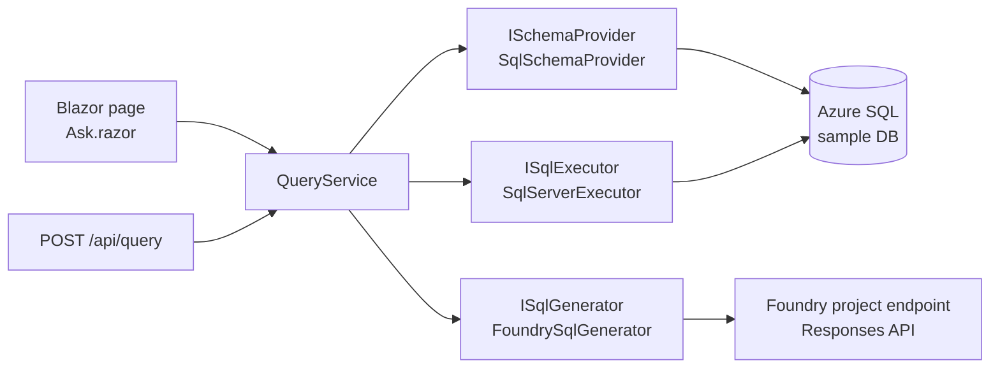

# Plan: Text-to-SQL API and website

Status: Approved

Requirements: [requirements.md](requirements.md)

## Stack and commands

- **.NET 10** (SDK 10.0.401 is installed, verified with `dotnet --list-sdks`), C# with nullable reference types enabled and warnings as errors via `Directory.Build.props`.
- **ASP.NET Core** minimal API plus a **Blazor Web App** (Interactive Server render mode) in one web project.
- **Microsoft.Data.SqlClient** for Azure SQL, with Entra ID authentication (`Authentication=Active Directory Default`).
- **Azure.AI.Projects**, **Azure.AI.Extensions.OpenAI**, and **Azure.Identity** for Foundry model calls.
- **xUnit** for tests. Exact package versions are chosen in phase 1 from NuGet.

| Purpose | Command |
|---|---|
| Build | `dotnet build TextToSql.slnx -warnaserror` |
| Test (default, Live excluded) | `dotnet test TextToSql.slnx --filter "Category!=Live"` |
| Test (Live only) | `dotnet test TextToSql.slnx --filter "Category=Live"` |
| Run (web + API) | `dotnet run --project src/TextToSql.Web` |
| Seed sample database | `dotnet run --project src/TextToSql.Web -- seed` |

Verified in phase 1: `dotnet new sln` produced `TextToSql.slnx`. The tests use xUnit 2.9.3 on the VSTest runner (`xunit.runner.visualstudio`, from the `dotnet new xunit` template), so the `--filter "Category!=Live"` and `--filter "Category=Live"` syntax works as written. `Microsoft.AspNetCore.Mvc.Testing` is pinned to 10.0.12 to match the installed ASP.NET Core runtime (10.0.15's dependencies did not resolve from nuget.org on 2026-11-10). Ports from `launchSettings.json`: `http://localhost:5212` (`--launch-profile http`), plus `https://localhost:7075` on the default `https` profile.

## Architecture

Flow for one question:

1. The page or the API validates the question: it must be non-empty and at most 1,000 characters.
2. `QueryService` gets the schema from `ISchemaProvider`, which caches it after the first read.
3. `ISqlGenerator` sends the schema and the question to Foundry and extracts the SQL from the reply.
4. `ISqlExecutor` runs the SQL with a 30-second timeout. It returns at most the first 50 rows of the first result set, or the rows-affected count.
5. The result (`QueryResult`: sql, columns, rows, rowsAffected, error) goes back to the caller.

| Project | Responsibility |
|---|---|
| `src/TextToSql.Core` | Domain types (`DatabaseSchema`, `QueryResult`), interfaces (`ISchemaProvider`, `ISqlGenerator`, `ISqlExecutor`), `QueryService`, the prompt constant, schema-to-text formatting, and SQL extraction from model output. No Azure dependencies. |
| `src/TextToSql.Web` | Host: configuration loading (including the `secrets.json` lookup), logging, DI wiring, the `/api/*` endpoints, the Blazor UI, the `seed` command, and the Azure implementations (`SqlSchemaProvider`, `SqlServerExecutor`, `FoundrySqlGenerator`). The seed script is an embedded SQL file. |
| `tests/TextToSql.Tests` | Unit tests against Core and the Web endpoints (`WebApplicationFactory`) using fakes, plus `Live`-tagged integration tests for Foundry and Azure SQL. |

Configuration keys (later sources win: `appsettings.json` → `secrets.json` → environment variables → command line):

- `Foundry:ProjectEndpoint` and `Foundry:DefaultDeployment`.
- `Sql:ConnectionString`: an Azure SQL connection string with `Authentication=Active Directory Default`. No password belongs in it. Changed from `Database:ConnectionString` in phase 2 to match the hosted web app's existing `Sql__ConnectionString` setting. `secrets.json` has no top-level connection string, so local development gets one from `appsettings.Development.json`, which points at `aiasst-sql-w3-m4gvse` / `appdb`. Those names are non-secret and already listed in `docs/environment.md`.
- `Query:MaxRows` (default 50), `Query:CommandTimeoutSeconds` (default 30), and `Query:MaxQuestionLength` (default 1000).

Missing required configuration produces a clear startup or request error naming the missing key, not a crash.

## Decisions

| # | Decision | Options | Why | Consequences |
|---|---|---|---|---|
| D1 | .NET 10, a single ASP.NET Core project hosting both the minimal API and the Blazor Web App (Interactive Server). The Blazor page calls `QueryService` in-process; the API endpoints call the same service. | Separate API and Blazor WASM projects; separate API and Blazor Server projects; one host. | The user asked for .NET and Blazor. One host means one project to build, run, and deploy, and no CORS or HTTP client between UI and API. The service layer keeps both paths identical. | The website does not go over HTTP to the API, so `/api/query` is tested separately through `WebApplicationFactory`. Splitting into two deployables later is a refactor, not a rewrite. |
| D2 | Plain Foundry model call through the **project endpoint** with the **Responses API**: `AIProjectClient(new Uri(endpoint), new DefaultAzureCredential())`, then `ProjectOpenAIClient.GetProjectResponsesClientForModel(deployment)` and `CreateResponseAsync`. Packages: `Azure.AI.Projects`, `Azure.AI.Extensions.OpenAI`, `Azure.Identity` (do **not** add `Azure.AI.Projects.OpenAI`, which conflicts). Sources: https://learn.microsoft.com/en-us/azure/foundry/how-to/develop/sdk-overview (updated 2026-10-19) and https://learn.microsoft.com/en-us/azure/foundry/quickstarts/get-started-code (updated 2026-10-19), read 2026-11-10. | Foundry agent; Chat Completions via the `/openai/v1` endpoint with an API key; Responses via the project endpoint. | The requirements say no agent and Entra ID authentication. The docs show only the Responses API for project-endpoint model calls in C#. | The identity needs the **Foundry User** role on the project and a working `az login`. The deployment name comes from `Foundry:DefaultDeployment`, which is not yet verified (`docs/environment.md` does not exist). Re-check the docs in phase 3 before writing the call. |
| D3 | Azure SQL through `Microsoft.Data.SqlClient` 7.x **plus** `Microsoft.Data.SqlClient.Extensions.Azure` (same version), using `Authentication=Active Directory Default`. Source: https://learn.microsoft.com/en-us/sql/connect/ado-net/sql/azure-active-directory-authentication (updated 2026-09-29), read 2026-11-10. | SQL login and password; Entra ID with an explicit token callback; Active Directory Default. | Matches the Entra-only approach in `CLAUDE.md`, with no password to store. Since 7.0, Entra modes need the Extensions.Azure package. | The developer's Entra identity must be a user in the database with read and write rights (DDL too, for seeding and because DROP is allowed). The first connection can be slow while the credential chain is probed. |
| D4 | All model-generated SQL is executed as-is: no statement-type filtering, the first result set only, capped at 50 rows, 30-second command timeout. | Read-only allow-list; read-only connection; execute everything. | The user's explicit decision in requirements (all statement types allowed). | Generated SQL can modify or drop sample data; `seed` restores it. Recorded under Known limitations. |
| D5 | The schema is read once from `INFORMATION_SCHEMA` and `sys.foreign_keys`, cached in memory, and formatted as compact text (`Table(col type PK, col type FK->Table.col)`) for the prompt. Only the schema and the question are sent to the model. | Send DDL; send sample rows; query the schema per request. | Small token footprint, no data leakage (requirements boundary), and a deterministic format that is easy to unit-test. | Schema changes (for example after a generated DROP) are not seen until restart. The `seed` command and app restart fix this. |
| D6 | xUnit tests: fakes for `ISqlGenerator`, `ISchemaProvider`, and `ISqlExecutor` in unit tests; `[Trait("Category", "Live")]` for tests against Foundry and Azure SQL, skipped when their config is missing. | MSTest; NUnit; xUnit. | xUnit is common for ASP.NET Core, and `WebApplicationFactory` works with it directly. | The exact runner setup (VSTest vs Microsoft Testing Platform) is decided in phase 1, and the commands above are adjusted to match. |

## Phases

| # | Title | Status | Demo command | Note |
|---|---|---|---|---|
| 1 | Scaffold, configuration, health endpoint | Done | `dotnet run --project src/TextToSql.Web`, then `curl http://localhost:<port>/api/health` | Solution, 3 projects, secrets.json locator + config order, `/api/health`; 11 tests passing |
| 2 | Sample database and schema reader | Done | `dotnet run --project src/TextToSql.Web -- seed`, then `curl http://localhost:<port>/api/schema` | seed.sql (6/30/100/300/750 rows), `seed` verb, `SqlSchemaProvider`, `SchemaFormatter`, `/api/schema`; 8 unit + 2 Live tests passing |
| 3 | Foundry SQL generation, execution, and `/api/query` | Done | `curl -X POST http://localhost:<port>/api/query -H "Content-Type: application/json" -d "{\"question\":\"How many customers are there?\"}"` | Prompt, `SqlExtractor`, `QueryService`, `FoundrySqlModelClient`, `SqlServerExecutor`, `POST /api/query` (200/400/422/502); 25 unit + 4 Live tests added |
| 4 | Blazor question page | Done | Run the app, open `/`, ask a question | `Ask.razor` replaces the placeholder home page: SQL, results table with truncation note, rows affected, or error; checked in the browser, no new tests (covered at service/API level) |
| 5 | Hardening (optional) | Not started | Same as phase 3/4 with error cases | First to cut |

### Phase 1: Scaffold, configuration, health endpoint

- **Goal:** a solution that builds with no warnings, runs, loads configuration in the required order, and has a passing test.
- **Scope:**
  - `TextToSql.slnx`, `Directory.Build.props` (`net10.0`, nullable, `TreatWarningsAsErrors`), and the three projects.
  - Configuration loading: `appsettings.json` → `secrets.json` (from `SECRETS_PATH`, otherwise walk up to the repo root, with the git worktree fallback to the main checkout) → environment variables → command line.
  - Console logging and `GET /api/health` returning `{ "status": "ok" }`.
  - The default Blazor layout with a placeholder home page.
- **Out of scope:** any Azure call or database work.
- **Tests:** the `secrets.json` locator:
  - uses `SECRETS_PATH` when it is set;
  - finds the file by walking up to the folder that contains `.git`;
  - falls back to the main checkout when `.git` is a worktree file;
  - returns "not found" cleanly when no file exists.

  These protect the configuration contract in `CLAUDE.md`. Also one `WebApplicationFactory` test that `/api/health` returns 200.
- **Acceptance criteria covered:** none directly. This is the foundation for all of them.
- **Demo:** `dotnet run --project src/TextToSql.Web`, then `curl http://localhost:<port>/api/health` → `{"status":"ok"}`. The browser shows the placeholder page.
- **Estimate:** 10 minutes.

### Phase 2: Sample database and schema reader

- **Goal:** the sample Azure SQL database exists and the app can describe its schema.
- **Scope:**
  - An embedded `seed.sql` that drops and recreates Categories, Products, Customers, Orders, and OrderItems with primary and foreign keys, plus a few hundred deterministic rows.
  - The `seed` command runs the script against `Sql:ConnectionString` and exits.
  - `SqlSchemaProvider` reads tables, columns, types, primary keys, and foreign keys.
  - The Core `SchemaFormatter` renders the schema as prompt text.
  - A dev-only `GET /api/schema` returns the formatted schema for the demo.
- **Out of scope:** model calls and query execution.
- **Tests:**
  - Unit: `SchemaFormatter` output includes every table, column, type, PK, and FK marker (AC2 format).
  - Live:
    - seeding twice yields the same row counts (AC1);
    - `SqlSchemaProvider` against the seeded DB returns all five tables with their keys (AC2).
- **Acceptance criteria covered:** AC1, AC2.
- **Demo:** `dotnet run --project src/TextToSql.Web -- seed` prints the tables created and their row counts. Then run the app and `curl http://localhost:<port>/api/schema`, which shows five tables with their PK and FK markers.
- **Estimate:** 10–12 minutes.
- **Blocked until:** `/azure-secrets` confirms an Azure SQL database and its connection details, and the developer's Entra identity has access.

### Phase 3: Foundry SQL generation, execution, and `/api/query`

- **Goal:** the first end-to-end path: an English question in, generated SQL plus the first 50 rows or the rows-affected count out.
- **Scope:**
  - The prompt constant.
  - `FoundrySqlGenerator`, built per D2 after re-reading the docs.
  - `SqlExtractor`, which strips markdown fences and commentary.
  - `SqlServerExecutor`: 30-second timeout, first result set, 50-row cap, rows affected for non-queries.
  - `QueryService` and `POST /api/query`. It returns 200 on success, 400 for an empty or too-long question (no model call), 422 with the SQL and the database error when execution fails (no retry), and 502 with a readable message when the model call fails.
  - Logging of the question, the SQL, timings, and errors. Result data and secrets are never logged.
- **Out of scope:** UI and retries.
- **Tests:**
  - Unit with fakes:
    - the request sent to the generator contains the schema text and the question, and nothing else (AC3);
    - `SqlExtractor` handles fenced, unfenced, and commented replies (AC4);
    - `QueryService` truncates to 50 rows (AC5) and passes rows affected through (AC6);
    - the endpoint returns 422 with the SQL and the error on an execution failure, and the generator is called once (AC7);
    - the endpoint returns 400 for an empty question with zero generator calls (AC8);
    - the endpoint returns 502 with no stack trace when the generator throws (AC9).
  - Live: "How many customers are there?" returns the seeded count (AC11).
- **Acceptance criteria covered:** AC3–AC9, AC11.
- **Demo:** run the app, then `curl -X POST http://localhost:<port>/api/query -H "Content-Type: application/json" -d "{\"question\":\"How many customers are there?\"}"`. The output is JSON with `sql` (a `SELECT COUNT(*) ... FROM Customers` query) and one row holding the seeded customer count.
- **Estimate:** 12 minutes.

### Phase 4: Blazor question page

- **Goal:** the website: ask a question, see the SQL and the results.
- **Scope:**
  - `Ask.razor` (Interactive Server) as the home page: a question textbox and an Ask button with a busy state.
  - Display of the generated SQL in a code block, plus one of: a results table (up to 50 rows, with a "showing first 50" note when capped), the rows-affected count, or the error message.
- **Out of scope:** history, charts, and styling beyond the default template.
- **Tests:** none planned unless the page gains logic beyond rendering `QueryResult`. The behavior is covered at the service and API level in phase 3, so a bUnit dependency would not earn its place.
- **Acceptance criteria covered:** AC10. It is verified manually through the demo.
- **Demo:** run the app, open `http://localhost:<port>/`, and ask "Top 5 products by total quantity ordered". The SQL and a 5-row table appear. Then ask a question that produces an error and confirm the message shows with no stack trace.
- **Estimate:** 8 minutes.

### Phase 5: Hardening (optional, first to cut)

- **Goal:** polish if time remains.
- **Scope:**
  - Clear startup errors for missing configuration keys.
  - Handling for a cancelled request and for timeouts.
  - A UI warning banner that statements can modify data.
  - A "Reset sample database" note in the README for writers.
- **Tests:** the missing-configuration path returns a readable error naming the key.
- **Demo:** start the app with `Sql:ConnectionString` unset. The error message names the key.
- **Estimate:** 5–8 minutes.

### Deviations recorded during implementation

- **Phase 3, generator split:** the plan's `ISqlGenerator` became `ISqlModelClient` (one prompt in, reply text out) behind `FoundrySqlModelClient`. Prompt building (`SqlPrompt`) and SQL extraction (`SqlExtractor`) live in Core inside `QueryService`, so AC3 and AC4 are unit-tested without Foundry.
- **Phase 3, prompt shape:** the documented C# Responses call takes a single input string (`CreateResponseAsync(string)`), and the docs show no separate system-instructions parameter for plain model calls, so the instructions, schema and question are sent as one input. Packages: `Azure.AI.Projects` 2.0.1, `Azure.AI.Extensions.OpenAI` 2.0.0 (pulls `OpenAI` 2.9.1), `Azure.Identity` 1.21.0, all stable. Docs re-read 2026-11-10 (quickstart updated 2026-10-19).
- **Phase 3, tenant pin:** `DefaultAzureCredential` on the developer machine returned a token from another tenant (an earlier credential in the chain), and Foundry answered `404 Workspace not found`. A raw REST call and `AzureCliCredential` both succeeded. The fix is the optional `Azure:TenantId` key (set in `appsettings.Development.json` to the tenant in `docs/environment.md`), passed to `DefaultAzureCredentialOptions.TenantId`. Azure SQL was unaffected because SqlClient takes the tenant from the server.
- **Phase 4:** `Ask.razor` replaces the template `Home.razor` as `/`. It reads the question limit from `QueryOptions` and shows a note that generated SQL runs as-is and `seed` resets the data.
- **Phase 3, response body:** `QueryResult` adds a `truncated` flag so the page can say "showing the first 50 rows".

## Parallel streams

- **Documentation** (`/write-docs`): can start as soon as this plan is approved.
- **Deployment pipeline** (`/deploy-pipeline`): once phase 1 is Done, because the project structure exists from then on. It needs `secrets.json` and Azure, so it runs in the main checkout.
- **Production review** (`/production-review`): after phase 3, the first end-to-end path.
- **Phase independence:** the phases are sequential. Phase 2 needs phase 1's config, phase 3 needs phase 2's schema reader, and phase 4 needs phase 3's service. None are suited to separate worktrees.
- **Ranges:** phases 3–4 can be run as a range (`/implement-phase 3-4`) if phase 3 goes smoothly.

## Risks

- **Azure SQL may not exist or may not be reachable.** `docs/environment.md` does not exist yet, so this is unverified. Phase 2 is blocked until `/azure-secrets` runs. Other possible blockers: the server firewall, Entra-only auth not configured, and the developer's identity not being a database user. If there is no Azure SQL, we need a decision from the user (for example, LocalDB or SQL in a container).
- **Foundry access:** `az login` must be done and the identity needs the **Foundry User** role on the project. The deployment name is unverified until `/azure-secrets` runs. Phase 3 is the first real call.
- **SDK churn:** the Foundry .NET packages (`Azure.AI.Extensions.OpenAI`) are recent, and the docs do not pin versions. Phase 3 re-checks the docs and records the versions used.
- **Model output quality:** generated SQL may use the wrong dialect or wrong names. The prompt states T-SQL and the exact schema. With no retry by design, errors surface to the user.
- **Time:** five phases plus setup is tight for about 60 minutes. Phase 5 is cut first, then phase 4 shrinks to a minimal page.

## Known limitations

- **All SQL statement types run unfiltered** (user decision). Generated `DELETE`, `UPDATE`, or `DROP` statements will change or destroy the sample data. Run `seed` to restore it. Not suitable for any real database.
- One fixed database from configuration; there is no database selector.
- Only the first result set is returned. Multi-batch scripts (`GO`) are not supported.
- The schema cache is not refreshed after DDL until the app restarts.
- `appdb` is a serverless database that auto-pauses. The first connection after a pause can fail with error 40613 ("not currently available") while it resumes; retrying a few seconds later works. There is no automatic retry.
- `Microsoft.Data.SqlClient` 7.1.1 pulls a vulnerable `System.Security.Cryptography.Pkcs` 9.0.18. The web project pins 10.0.14 directly; remove the pin once SqlClient ships with a patched dependency.
- No authentication, rate limiting, or cost or token budget.
- No retry or self-correction when the generated SQL fails.
